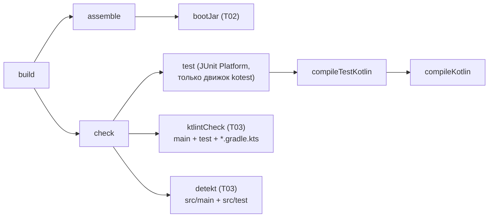
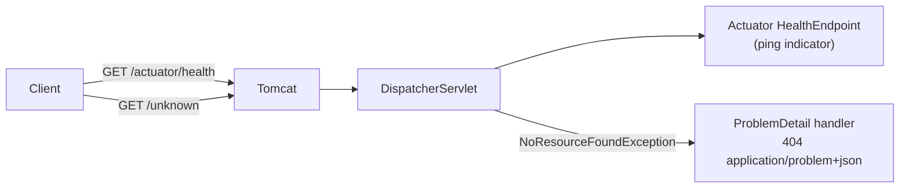
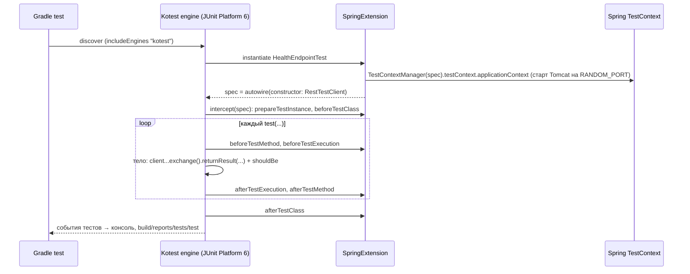

# F-001: Архитектура решения

| Поле   | Значение   |
|--------|------------|
| Автор  | architect  |
| Дата   | 2026-10-23 |
| ADR    | [ADR-0001](../../architecture/adr/ADR-0001-jdk-17.md), [ADR-0002](../../architecture/adr/ADR-0002-gradle-build.md), [ADR-0003](../../architecture/adr/ADR-0003-spring-boot-web-mvc.md), [ADR-0004](../../architecture/adr/ADR-0004-code-quality-ktlint-detekt.md), [ADR-0005](../../architecture/adr/ADR-0005-kotest-testing.md) |

## Контекст
Репозиторий — IntelliJ-модуль (`auto-statistic.iml`, `src/Main.kt`, библиотека `KotlinJavaRuntime`) без системы
сборки. Нужен воспроизводимый Gradle-проект с каркасом Spring Boot (health-check) и проверками качества,
роняющими сборку. Решения пользователя: Q1 — Spring Boot входит; Q3 — проверки сразу и ронят сборку;
Q5 — **JDK 17**; Q2/Q4 — БД, CI, Docker вне объёма. Бизнес-логики, доменной модели и БД в фиче нет.
Дополнение пользователя (2026-10-23): тесты — на **Kotest**, и раннер, и проверки, без JUnit `@Test` (Q7, подтверждено
пользователем) — решение [ADR-0005](../../architecture/adr/ADR-0005-kotest-testing.md).

Ограничения: Windows — основная машина (Git Bash/PowerShell), Gradle не установлен, установлены JDK 17
(Liberica 17.0.11, Corretto 17.0.8.1).

## Компоненты и границы

### Итоговая структура репозитория (после T01–T03)
```
auto-statistic/
├── .editorconfig                      (T03) правила ktlint + IDE
├── .gitattributes                     (T01) eol: gradlew=LF, *.bat=CRLF
├── .gitignore                         (T01) + build/, .gradle/, *.iml, .idea/
├── build.gradle.kts                   (T01, расширяется в T02, T03)
├── settings.gradle.kts                (T01)
├── gradle.properties                  (T01)
├── gradle/
│   ├── libs.versions.toml             (T01, расширяется в T02, T03)
│   └── wrapper/gradle-wrapper.{jar,properties}  (T01)
├── gradlew, gradlew.bat               (T01)
├── config/detekt/detekt.yml           (T03)
└── src/
    ├── main/kotlin/com/autostatistic/AutoStatisticApplication.kt   (T02)
    ├── main/resources/application.yaml                             (T02)
    └── test/kotlin/com/autostatistic/
        ├── BuildSmokeTest.kt                    (T01) FunSpec, без Spring; остаётся после T02
        ├── AutoStatisticApplicationTest.kt      (T02) FunSpec + @SpringBootTest + SpringExtension
        ├── HealthEndpointTest.kt                (T02) FunSpec + @SpringBootTest(RANDOM_PORT) + RestTestClient
        └── PortInUseTest.kt                     (T02) FunSpec, без Spring-расширения
```
Удаляются: `src/Main.kt`, `auto-statistic.iml`, `.idea/libraries/KotlinJavaRuntime.xml` (последние два — артефакты
старой конфигурации модуля; `.idea/` целиком игнорируется git'ом и пересоздаётся IDE при импорте Gradle).

### Задачи Gradle (что выполняет `./gradlew build`)


Эталонная настройка задачи `test` (T01; при правках `build.gradle.kts` в T02/T03 не терять, движки расширяются только по ADR):
```kotlin
import org.gradle.api.tasks.testing.logging.TestExceptionFormat

tasks.test {
    useJUnitPlatform { includeEngines("kotest") }
    testLogging {
        events("passed", "skipped", "failed")
        exceptionFormat = TestExceptionFormat.FULL
    }
}
```
`exceptionFormat = FULL` обязателен: с форматом по умолчанию (`SHORT`) в выводе Gradle только класс исключения и строка
(`AssertionFailedError at BuildSmokeTest.kt:8`) без текста несовпадения `expected:<…> but was:<…>`, который требует AC-3 T01.
`failOnNoDiscoveredTests` не трогается (дефолт Gradle 9 — `true`).

### Рантайм (T02)

Собственных бинов/контроллеров нет — только конфигурация Boot.

## Версии (фиксируются в `gradle/libs.versions.toml`)
| Компонент | Версия | Где | Источник решения |
|-----------|--------|-----|------------------|
| Gradle Wrapper | 9.3.1 (bin, с `distributionSha256Sum`) | wrapper | ADR-0002 |
| JDK (toolchain) | 17 | `kotlin { jvmToolchain(17) }` | ADR-0001 |
| Kotlin (`org.jetbrains.kotlin.jvm`, `plugin.spring`) | 2.3.21 | catalog | ADR-0002 |
| JUnit BOM (только T01, до появления Boot BOM) | 6.0.3 | catalog | ADR-0002 |
| Kotest BOM (`io.kotest:kotest-bom`): `kotest-runner-junit6`, `kotest-assertions-core` (T01), `kotest-extensions-spring` (T02) | 6.2.6 | catalog | ADR-0005 |
| Spring Boot (`org.springframework.boot`) | 4.1.2 | catalog | ADR-0003 |
| ktlint-gradle (`org.jlleitschuh.gradle.ktlint`) | 14.2.0 | catalog | ADR-0004 |
| ktlint (движок) | 1.8.0 | catalog | ADR-0004 |
| detekt (`dev.detekt`) | 2.0.0-alpha.3 | catalog | ADR-0004 |

Остальные библиотеки — без версий, из Spring Boot BOM (Spring, JUnit Platform, coroutines, byte-buddy) или Kotest BOM (модули Kotest).
Сверка совместимости Kotest 6.2.6: собран Kotlin 2.2.21 (читается Kotlin 2.3.21), байткод Java 11 (JDK 17 ок),
POM `kotest-runner-junit6` объявляет JUnit Platform/Jupiter API **6.0.3** и coroutines **1.10.2** — ровно версии BOM Boot 4.1.2
(сам движок — в общем `kotest-runner-junit-platform`; `-junit6` выравнивает объявленные зависимости под Platform 6);
`kotest-extensions-spring` вызывает только API Spring TestContext, присутствующие в Spring 7.0.10 (подробно — ADR-0005).

## API
| Метод | Путь | Запрос | Ответ | Ошибки |
|-------|------|--------|-------|--------|
| GET | `/actuator/health` | — | `200`, тело `{"status":"UP"}`; в Boot 4.1.2 допускается дополнительное поле `groups` (имена групп проб, напр. `["liveness","readiness"]`), детали индикаторов не раскрываются (`show-details: never`); контракт — только поле `status` (content-type `application/vnd.spring-boot.actuator.v3+json` или `application/json`) | `503 {"status":"DOWN"}` — если индикатор недоступен (в F-001 только `ping`, практически не возникает) |
| * | любой неизвестный путь | — | — | `404`, `application/problem+json`: `{"type":"about:blank","title":"Not Found","status":404,"detail":...,"instance":"/путь"}` |

Другие actuator-эндпоинты по HTTP **не** экспонируются (`/actuator/info`, `/actuator/env` → 404).
Discovery-страница `GET /actuator` (`200`, HAL-ссылки только на `self` и `health`) **остаётся включённой**: она перечисляет лишь
экспонированные эндпоинты (сейчас — только `health`), внутренних данных не раскрывает, AC не противоречит; отключение
(`management.endpoints.web.discovery.enabled: false`) сейчас — YAGNI. Пересмотреть при расширении exposure (`info`, `metrics`,
`prometheus`) или при появлении требований безопасности (вместе с защитой management-эндпоинтов). `/actuator` контрактом API
не является — клиенты и проверки на него не полагаются.
Порт по умолчанию 8080; переопределение — `SERVER_PORT` или `--server.port`.

## Модель данных
Нет (БД вне объёма, Q2). Стартеры JDBC/JPA/Flyway не подключаются — иначе Boot попытается сконфигурировать DataSource (AC-5 T02).

## Доменная модель
Нет. Фича только закладывает структуру пакетов (`overview.md`, раздел «Координаты и структура пакетов»).

## Потоки
1. **Сборка** `./gradlew build`: toolchain находит JDK 17 → компиляция Kotlin → тесты (JUnit Platform, только движок `kotest`;
   0 обнаруженных тестов при наличии тестовых исходников → падение, Gradle 9 `failOnNoDiscoveredTests`) → ktlintCheck →
   detekt → bootJar. Любой упавший шаг → `BUILD FAILED` с сообщением инструмента (файл:строка:правило / имя теста /
   ошибка компилятора).
2. **Запуск** `./gradlew bootRun`: Boot стартует Tomcat на 8080, в логе `Tomcat started on port 8080`,
   `Started AutoStatisticApplicationKt` (Boot логирует класс, где объявлен `main`; для top-level `fun main` это `AutoStatisticApplicationKt`).
3. **Health**: `GET /actuator/health` → `200 {"status":"UP"}` (допускается поле `groups` с именами проб, см. «API»).
4. **Неизвестный путь**: `GET /nope` → `NoResourceFoundException` → `ProblemDetail` 404; приложение продолжает работать.
5. **Порт занят**: Tomcat не может открыть порт → `PortInUseException` → FailureAnalyzer печатает
   `Web server failed to start. Port 8080 was already in use.` + `Action: ... configure this application to listen on another port`,
   контекст закрывается, процесс завершается с ненулевым кодом (без зависания).

## Как проверяется (стратегия тестирования)
Все автотесты — Kotest-спецификации `FunSpec` (ADR-0005): `test("<поведение>") { … }`, проверки — только Kotest-матчеры.
Spring-спецификации: `@SpringBootTest(...)` + `@ApplyExtension(SpringExtension::class)`, бины — параметрами конструктора спецификации.



| Что | Спецификация / тест | Тип |
|-----|---------------------|-----|
| Kotest-тесты обнаруживаются и участвуют в сборке | `BuildSmokeTest` — `test("tests run on the JDK 17 toolchain")` (T01; остаётся в T02) | auto |
| 0 тестов → сборка не «зелёная» | Gradle 9 `failOnNoDiscoveredTests = true` (дефолт, не отключать). Негатив (не коммитить): `useJUnitPlatform { includeEngines("kotest"); excludeEngines("kotest") }` → `:test FAILED`, «…the test task did not discover any tests…», `BUILD FAILED`; доп. `includeEngines("kotest-typo")` → `:test FAILED` (`No TestEngine ID matched…`). Пустая `FunSpec({})` — **не** негатив: Kotest отдаёт её как один тест (`tests="1"`), сборка зелёная; ловится ревью (`failOnEmptyTestSuite` не включаем, ADR-0005) | свойство сборки / manual QA |
| Контекст поднимается без БД | `AutoStatisticApplicationTest` — `test("context loads without database")` | auto (`@SpringBootTest`) |
| Health `200/UP` по реальному HTTP | `HealthEndpointTest` — RANDOM_PORT + `RestTestClient` | auto |
| 404 на неизвестный путь, problem+json, приложение живо | `HealthEndpointTest` (отдельный `test`) | auto |
| Не экспонируются лишние actuator-эндпоинты | `HealthEndpointTest`: `/actuator/env` → 404 | auto |
| Занятый порт → понятная ошибка, порт переопределяется | `PortInUseTest`: занять порт `ServerSocket(0)`, запустить приложение с `--server.port=<занятый>`, ожидать `PortInUseException` в цепочке причин | auto |
| Нет JUnit/AssertJ-тестов | detekt `ForbiddenImport` (T03) + `includeEngines("kotest")` | auto (с T03) / review |
| Падающий Kotest-тест (в т.ч. Spring) / ошибка компиляции / нарушения ktlint/detekt роняют сборку | временные правки (не коммитятся) | manual (QA) |
| Импорт в IntelliJ | открыть `build.gradle.kts` как проект | manual (QA/пользователь) |

## Альтернативы
См. разделы «Рассмотренные альтернативы» в ADR-0001..0004. Ключевое:
- JDK 21 → отклонено пользователем (JDK 17).
- Kotlin 2.4 + Gradle 9.8 → отклонено: Kotlin 2.4 не управляется Boot 4.1, KGP 2.3 поддерживает Gradle ≤ 9.3.
- WebFlux → отклонено: блокирующий JDBC в планах, лишняя сложность.
- detekt 1.23.x (stable) → несовместим с Kotlin 2.3/Gradle 9; выбран 2.0.0-alpha.3, совпадающий с нашим стеком по таблице совместимости.
- `io.spring.dependency-management` → заменён на `platform(SpringBootPlugin.BOM_COORDINATES)`.
- JUnit Jupiter + AssertJ → заменены на Kotest по требованию пользователя; `kotest-runner-junit5` отклонён в пользу
  `kotest-runner-junit6`: движок у обоих общий (`kotest-runner-junit-platform`, исполняется на Platform 6.0.3 из BOM Boot),
  а POM `-junit6` объявляет JUnit Platform 6.0.3 — ровно как BOM Boot 4.1.2 (у `-junit5` — 1.13.4); стили кроме `FunSpec`,
  глобальный `ProjectConfig` со `SpringExtension`, Kotest Gradle-плагин, `kotest-assertions-json` — отклонены (ADR-0005).

## Риски и открытые вопросы
- **detekt alpha** (ADR-0004): возможны баги/ложные срабатывания. Смягчение: фиксированная версия, минимальная
  дельта-конфигурация, явный `failOnSeverity = Error`. Переход на более новую alpha — только при проверенно зелёном
  `./gradlew build` на нашем стеке (Gradle 9.3.1 + Kotlin 2.3.21) с обоснованием в «Реализации» T03, иначе — эскалация к architect.
- **Генерация wrapper без установленного Gradle**: разработчику нужно разово скачать `gradle-9.3.1-bin.zip`
  (или использовать IntelliJ) для `gradle wrapper`. Описано в плане T01.
- **Бит исполнения `gradlew` на Windows**: NTFS не хранит x-бит; нужно явно `git update-index --chmod=+x gradlew`
  (проверяется `git ls-files -s gradlew` → режим `100755`). Файлы ещё не закоммичены — бит ставится при первом `git add`.
- **Конфликт правил ktlint ↔ detekt** (длина строки и пр.): решается отключением дублирующих правил detekt.
- **Правило detekt `SpreadOperator`** на `runApplication<…>(*args)` в `main`: допускается точечный `@Suppress("SpreadOperator")`
  на функции `main` с комментарием-причиной (единственное разрешённое подавление в F-001).
- **Кириллица в выводе/исходниках на Windows**: `org.gradle.jvmargs=-Dfile.encoding=UTF-8` в `gradle.properties`.
- **`kotest-extensions-spring` на Spring 7 / Boot 4** (ADR-0005): командой Kotest тестируется на Spring 5.3; бинарная
  совместимость используемых API со Spring 7.0.10 проверена, использование на Boot 4 известно (kotest#5666). Если расширение
  реально не работает — применяется **предсогласованный запасной вариант** (решение пользователя 2026-10-23, ADR-0005 «Запасной вариант»),
  без эскалации и без повторного согласования:
  - триггер: сбой со стеком в `io.kotest.extensions.spring.*`/вызовах `TestContextManager` (или спека не инстанцируется / Spring-тесты
    не исполняются), зависимости совпадают с планом, и **контрольный прогон** той же проверки на JUnit Jupiter зелёный;
  - на JUnit Jupiter переводятся **только** классы с `@SpringBootTest` (`AutoStatisticApplicationTest`, `HealthEndpointTest`);
    `BuildSmokeTest`, `PortInUseTest` и будущие тесты без Spring-контекста остаются Kotest `FunSpec`;
  - проверки везде — Kotest-матчеры; JUnit `Assertions`/`Assumptions`, AssertJ, Hamcrest, `kotlin.test` запрещены;
  - сборка: `kotest-extensions-spring` удаляется, `testImplementation(libs.junit.jupiter)` (без версии, BOM Boot),
    `includeEngines("kotest", "junit-jupiter")`; инъекция — конструктор + `@TestConstructor(autowireMode = ALL)` на классе;
  - T03: в `ForbiddenImport` — белый список: `forbiddenImports` без изменений (`org.junit.*`, `org.assertj.*`, `org.hamcrest.*`,
    `kotlin.test.*`) + `allowedImports: ['org.junit.jupiter.api.Test']` — разрешён ровно этот импорт, прочие API JUnit (в т.ч.
    `org.junit.jupiter.api.assertThrows`, `@Disabled`, `import org.junit.jupiter.api.*`) запрещены; «JUnit только в `@SpringBootTest`-классах» — контроль ревью;
  - правки `conventions.md`, `overview.md`, этого документа (таблица «Как проверяется», строка «Нет JUnit/AssertJ-тестов»;
    «Транзитивный JUnit Jupiter»), отметка в ADR-0005 — перечень в ADR-0005; причина и ошибка — в «Реализации» T02.
  Иные обходы (`@Autowired lateinit`, ручной подъём контекста, отказ от проверок) по-прежнему запрещены.
- **Предупреждение «SpringExtension on a final class»** не должно появляться: `@SpringBootTest`-классы открывает `kotlin-spring`.
  Если появилось — плагин не применён или аннотация не та; не глушить системным свойством.
- **Транзитивный JUnit Jupiter** (через `spring-boot-starter-test`): движок не исполняется (`includeEngines("kotest")`),
  импорты `org.junit.*` запрещены detekt (T03). Исключать артефакт из зависимостей не нужно.
- Блокирующих вопросов к пользователю нет (Q7 закрыт: Kotest — раннер и assertions).

## Порядок реализации задач
T01 → T02 → T03 (строго последовательно).

T03 изначально зависела только от T01, но T02 и T03 правят одни и те же файлы (`build.gradle.kts`,
`libs.versions.toml`), а проверки T03 должны проходить на коде каркаса Spring Boot (AC-1 T03) — поэтому
T03 зависит от T02.
