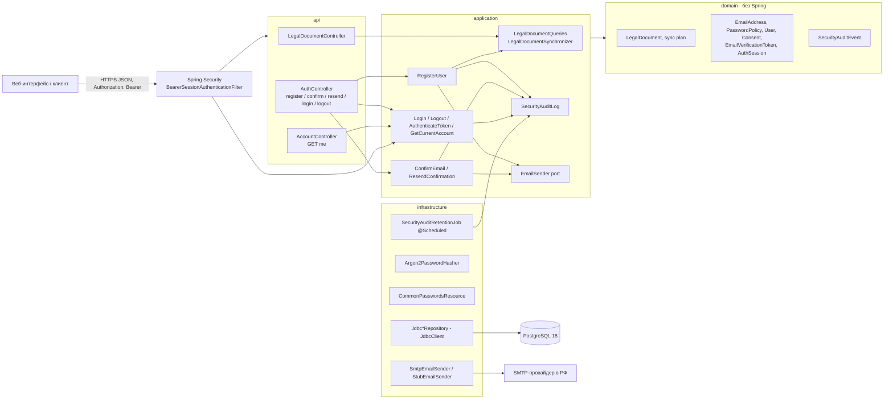
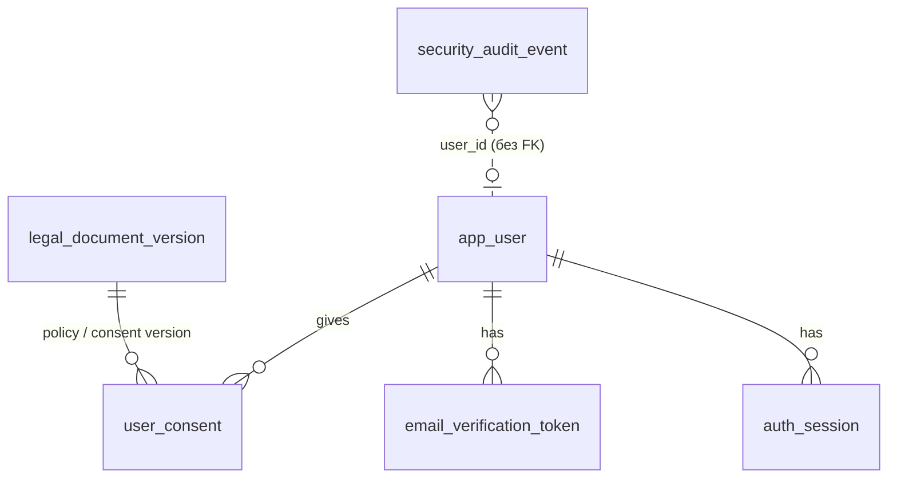
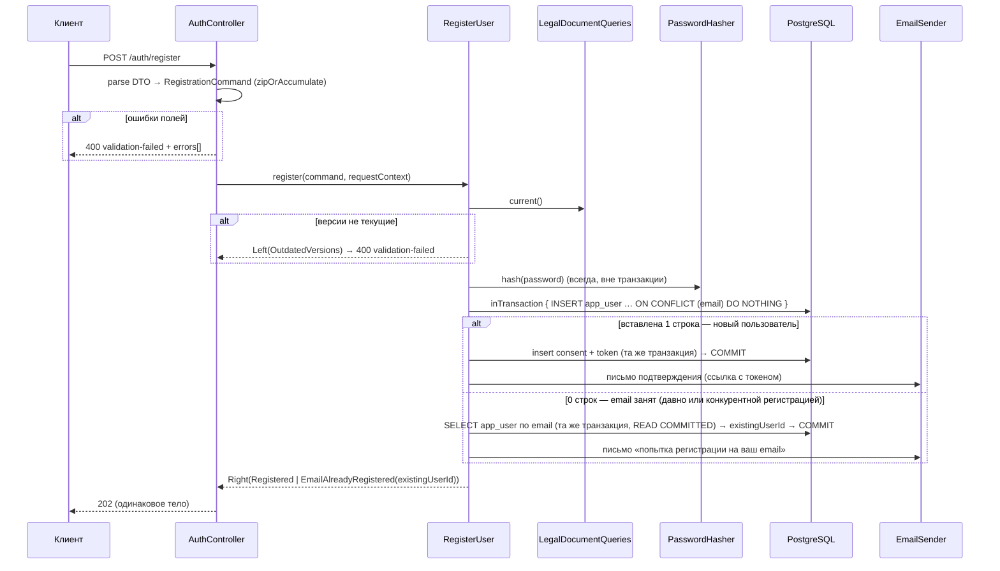
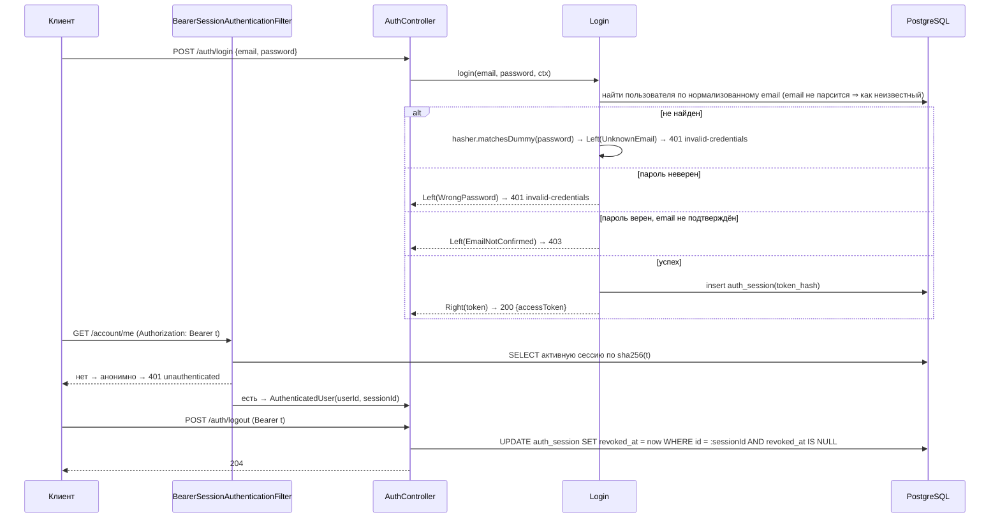

# F-002: Архитектура решения

| Поле   | Значение   |
|--------|------------|
| Автор  | architect  |
| Дата   | 2026-11-08 |
| ADR    | [ADR-0007](../../architecture/adr/ADR-0007-postgresql-flyway-jdbcclient.md) хранилище, [ADR-0008](../../architecture/adr/ADR-0008-arrow-errors-as-values.md) ошибки/транзакции/формат ошибок API, [ADR-0009](../../architecture/adr/ADR-0009-auth-opaque-bearer-sessions.md) сессии, [ADR-0010](../../architecture/adr/ADR-0010-password-hashing-argon2id.md) пароли, [ADR-0011](../../architecture/adr/ADR-0011-email-smtp-stub.md) почта, [ADR-0012](../../architecture/adr/ADR-0012-security-audit-log.md) аудит |

## Контекст
Первая фича с данными и первая доменная логика. Пользователь регистрируется по email/паролю с согласием на обработку
ПДн (версии документов), подтверждает email по одноразовой ссылке, входит (непрозрачный bearer-токен серверной сессии),
выходит; все непубличные ресурсы закрыты; события безопасности пишутся в журнал аудита.

Текущее состояние кода (2026-11-08): только `AutoStatisticApplication`, `application.yaml` (exposure `health`),
тесты F-001 (`HealthEndpointTest`, `AutoStatisticApplicationTest` — проверяет **отсутствие** `DataSource`,
`PortInUseTest`, `ServerPortOverrideTest`, `BuildSmokeTest`). F-012/T02 (`/actuator/info`) ещё не слита — F-002 должна
корректно работать в обоих состояниях (путь `/actuator/info` заранее публичный).

Ограничения: Kotlin 2.3.21 / Boot 4.1.2 / Kotest 6.2.6 (ADR-0001..0005); ПДн в РФ (FR-PD-1, требование к эксплуатации);
домен, отправитель и юридические тексты не известны (PRD O1–O3) — только конфигурация и заглушки; сроки сессий,
ограничение частоты, смена/восстановление пароля — F-003.

## Компоненты и границы



### Пакеты (новые)
```
com.autostatistic
├── shared/                         ← T01–T04, только то, что реально нужно двум и более контекстам
│   ├── domain/        EmailAddress (+ EmailAddressError), IpAddress, UserAgent, RequestContext,
│   │                  SecretToken, TokenHash
│   ├── application/   TransactionRunner, SecretTokenGenerator (порт)
│   ├── api/           ApiProblems, RequestContextArgumentResolver, SharedWebMvcConfiguration
│   └── infrastructure/ ClockConfiguration, TransactionConfiguration, SecureRandomTokenGenerator,
│                      WebProperties (app.web.*), WebLinks
├── legal/                          ← T02: версии политики и согласия
│   ├── api/ application/ domain/ infrastructure/
├── mail/                           ← T03: EmailSender, заглушка, SMTP
│   ├── application/ infrastructure/
├── account/                        ← T04–T06: пользователь, согласие, подтверждение email, сессии, Spring Security
│   ├── api/ application/ domain/ infrastructure/ (infrastructure/security/)
└── audit/                          ← T07: журнал аудита
    ├── application/ domain/ infrastructure/
```
Зависимости между контекстами — только application → application (порт/сервис другого контекста):
`account.application` → `legal.application` (текущие версии), `mail.application` (`EmailSender`),
`audit.application` (`SecurityAuditLog`, с T07). Обратных зависимостей нет. Домен любого контекста может
использовать `shared.domain`.

## API
Базовый префикс — `/api/v1`. Все тела — JSON (UTF-8). Ошибки — ProblemDetail в формате ADR-0008 (`type`
`urn:auto-statistic:problem:<code>`, `title`, `status`, `detail`, `instance`, `code`, для валидации — `errors[]`).

| Метод | Путь | Доступ | Запрос | Ответ | Ошибки | Задача |
|-------|------|--------|--------|-------|--------|--------|
| GET | `/actuator/health` | публичный | — | `200 {"status":"UP","components":{"db":{"status":"UP"},"diskSpace":{…},"ping":{…}}}` — только `status` у компонентов | `503`, `status: DOWN` (БД недоступна) | T01 |
| GET | `/api/v1/legal-documents/current` | публичный | — | `200 {"documents":[LegalDocument, LegalDocument]}` — по одному на тип, порядок `PRIVACY_POLICY`, `PERSONAL_DATA_CONSENT` | — | T02 |
| GET | `/api/v1/legal-documents/{versionId}` | публичный | — | `200 LegalDocument` | `404 legal-document-not-found` | T02 |
| POST | `/api/v1/auth/register` | публичный | `RegisterRequest` | `202 {"message":"Мы отправили письмо на указанный адрес. Перейдите по ссылке из письма, чтобы подтвердить email."}` — одинаково для нового и занятого email | `400 validation-failed` | T04 |
| POST | `/api/v1/auth/email-confirmation` | публичный | `{"token": string}` | `200 {"message":"Email подтверждён. Теперь можно войти."}` | `400 validation-failed` (нет `token`); `400 confirmation-link-invalid`; `400 confirmation-link-used`; `400 confirmation-link-expired` | T05 |
| POST | `/api/v1/auth/email-confirmation/resend` | публичный | `{"email": string}` | `202 {"message":"Если для этого адреса нужно подтверждение, мы отправили новое письмо."}` — одинаково во всех случаях | `400 validation-failed` (нет/неверный формат `email`) | T05 |
| POST | `/api/v1/auth/login` | публичный | `{"email": string, "password": string}` | `200 {"accessToken": string, "tokenType":"Bearer"}` | `400 validation-failed` (поле отсутствует/пустое); `401 invalid-credentials`; `403 email-not-confirmed` (+ расширение `resendConfirmationPath: "/api/v1/auth/email-confirmation/resend"`) | T06 |
| POST | `/api/v1/auth/logout` | вход | — (заголовок `Authorization: Bearer …`) | `204` | `401 unauthenticated` | T06 |
| GET | `/api/v1/account/me` | вход | — | `200 {"email": string, "name": string \| null}` | `401 unauthenticated` | T06 |
| * | любой другой путь | вход | — | как у ресурса | `401 unauthenticated` без входа (в т.ч. несуществующий путь); `404` с входом | T06 |

Публичные пути (`permitAll`, любой метод; ADR-0009): `/actuator/health`, `/actuator/health/**`, `/actuator/info`,
`/api/v1/legal-documents/**`, `/api/v1/auth/register`, `/api/v1/auth/email-confirmation`,
`/api/v1/auth/email-confirmation/resend`, `/api/v1/auth/login`, а также диспетчеризация `ERROR`.
`/api/v1/auth/logout` — **не** публичный.

**`LegalDocument`**: `{"type":"PRIVACY_POLICY"|"PERSONAL_DATA_CONSENT","versionId":"privacy-policy-stub-1","effectiveFrom":"2026-01-01","text":"…","stub":true}`.

**`RegisterRequest`** (все поля nullable в DTO — отсутствие поля даёт ошибку поля):
```json
{ "email": "user@example.com", "password": "…", "name": "Иван",
  "personalDataConsent": true, "privacyPolicyAccepted": true,
  "privacyPolicyVersionId": "privacy-policy-stub-1", "consentVersionId": "personal-data-consent-stub-1" }
```

**Коды ошибок полей регистрации** (`errors[].field` / `errors[].code` / `errors[].message`):

| field | code | message |
|-------|------|---------|
| `email` | `REQUIRED` | Укажите email |
| `email` | `INVALID_FORMAT` | Некорректный формат email |
| `email` | `TOO_LONG` | Email не длиннее 254 символов |
| `password` | `REQUIRED` | Укажите пароль |
| `password` | `TOO_SHORT` | Пароль не короче 12 символов |
| `password` | `TOO_LONG` | Пароль не длиннее 128 символов |
| `password` | `EQUALS_EMAIL` | Пароль не должен совпадать с email |
| `password` | `COMMON_PASSWORD` | Этот пароль слишком распространён или встречался в утечках, выберите другой |
| `name` | `TOO_LONG` | Имя не длиннее 100 символов |
| `personalDataConsent` | `CONSENT_REQUIRED` | Без согласия на обработку персональных данных регистрация невозможна |
| `privacyPolicyAccepted` | `ACCEPTANCE_REQUIRED` | Примите политику конфиденциальности |
| `privacyPolicyVersionId`, `consentVersionId` | `REQUIRED` | Укажите версию документа (поле отсутствует, пустое или из пробелов) |
| `privacyPolicyVersionId`, `consentVersionId` | `NOT_CURRENT_VERSION` | Примите актуальную версию документа (нетекущая, несуществующая или синтаксически неверная — не проходит `LegalDocumentVersionId.parse`) |

Пароль проверяется, даже если email невалиден (без правила `EQUALS_EMAIL`), — все ошибки полей возвращаются одним ответом.
В колонке `message` в скобках — пояснение для разработчика, в ответ не входит.

**Коды ProblemDetail фичи:**

| code | status | title | detail |
|------|--------|-------|--------|
| `validation-failed` | 400 | Некорректные данные | Проверьте поля запроса (+ `errors[]`) |
| `legal-document-not-found` | 404 | Документ не найден | Версия документа не найдена |
| `confirmation-link-invalid` | 400 | Ссылка недействительна | Ссылка недействительна |
| `confirmation-link-used` | 400 | Ссылка недействительна | Ссылка уже использована или недействительна |
| `confirmation-link-expired` | 400 | Срок действия ссылки истёк | Срок действия ссылки истёк. Запросите новое письмо |
| `invalid-credentials` | 401 | Ошибка входа | Неверный email или пароль |
| `email-not-confirmed` | 403 | Email не подтверждён | Подтвердите email по ссылке из письма. Если письма нет — запросите его повторно |
| `unauthenticated` | 401 | Требуется вход | Войдите, чтобы продолжить |

## Модель данных
Миграции — `src/main/resources/db/migration`. Все `NOT NULL`, если не сказано иное; время — `timestamptz`.

| Файл | Задача | Содержимое |
|------|--------|------------|
| `V001__baseline.sql` | T01 | Только комментарий-заголовок и `SELECT 1;` — фиксирует начало истории Flyway (проверка AC-1 T01) |
| `V002__legal_document_version.sql` | T02 | `legal_document_version` + триггер неизменяемости |
| `V003__app_user_consent_verification.sql` | T04 | `app_user`, `user_consent`, `email_verification_token` |
| `V004__auth_session.sql` | T06 | `auth_session` |
| `V005__security_audit_event.sql` | T07 | `security_audit_event` + триггер запрета `UPDATE` |



**`legal_document_version`** (T02)
| Колонка | Тип | Примечание |
|---------|-----|------------|
| `id` | `varchar(64)` PK | идентификатор версии от оператора, `^[a-z0-9][a-z0-9.-]{0,63}$` |
| `type` | `varchar(32)` | `CHECK (type IN ('PRIVACY_POLICY','PERSONAL_DATA_CONSENT'))` |
| `effective_from` | `date` | дата вступления в силу |
| `content` | `text` | текст документа (`CHECK (length(content) > 0)`) |
| `stub` | `boolean` | признак заглушки |
| `published_at` | `timestamptz` | когда версия впервые сохранена |

`UNIQUE (type, effective_from)` (индекс заодно обслуживает выбор текущей версии:
`WHERE type = :type AND effective_from <= :today ORDER BY effective_from DESC LIMIT 1`).
Триггер `legal_document_version_immutable` (`BEFORE UPDATE OR DELETE … RAISE EXCEPTION`) — опубликованная версия неизменяема.

**`app_user`** (T04)
| Колонка | Тип | Примечание |
|---------|-----|------------|
| `id` | `uuid` PK | |
| `email` | `varchar(254)` | нормализованный (trim + lower), `UNIQUE` (`app_user_email_uk`; цель `INSERT … ON CONFLICT (email) DO NOTHING` при регистрации), `CHECK (email = lower(email))` |
| `display_name` | `varchar(100)` NULL | |
| `password_hash` | `varchar(255)` | `{argon2id-v1}$argon2id$…` |
| `email_confirmed_at` | `timestamptz` NULL | `NULL` = email не подтверждён |
| `created_at` | `timestamptz` | |

**`user_consent`** (T04): `id uuid PK`, `user_id uuid FK → app_user`, `privacy_policy_version_id varchar(64) FK →
legal_document_version`, `consent_version_id varchar(64) FK → legal_document_version`, `given_at timestamptz`,
`ip inet`. Индекс `user_consent_user_id_idx (user_id)`. Соответствие типов версий проверяет приложение.

**`email_verification_token`** (T04, используется T05): `id uuid PK`, `user_id uuid FK → app_user`,
`token_hash varchar(64) UNIQUE` (SHA-256 hex), `created_at`, `expires_at`, `used_at NULL`, `revoked_at NULL`.
Частичный индекс `email_verification_token_active_idx (user_id) WHERE used_at IS NULL AND revoked_at IS NULL` —
отзыв активных токенов при повторной отправке.

**`auth_session`** (T06): `id uuid PK`, `user_id uuid FK → app_user`, `token_hash varchar(64) UNIQUE`, `created_at`,
`revoked_at NULL`. Индекс по `user_id` и колонки сроков — в F-003 (ADR-0009, п. 6).

**`security_audit_event`** (T07): по ADR-0012 — `id uuid PK`, `occurred_at`, `event_type varchar(64)`,
`outcome varchar(64)`, `user_id uuid NULL` (без FK), `subject_email varchar(254) NULL`, `ip inet NULL`,
`user_agent varchar(512) NULL`; индекс `security_audit_event_occurred_at_idx (occurred_at)`; триггер запрета `UPDATE`.

## Доменная модель

### shared.domain
- `EmailAddress` — value class, smart-конструктор `parse(raw: String): Either<EmailAddressError, EmailAddress>`:
  `trim()` → пусто ⇒ `Blank`; длина > 254 ⇒ `TooLong`; не соответствует формату ⇒ `InvalidFormat`; результат —
  `lowercase(Locale.ROOT)`. Формат (прагматичный, только ASCII): одна `@`, локальная часть 1–64 символа из
  `A-Za-z0-9.!#$%&'*+/=?^_`{|}~-` без ведущей/замыкающей/двойной точки, домен — метки `[A-Za-z0-9-]` (1–63, без `-`
  по краям) через точку, минимум две метки. `sealed interface EmailAddressError { Blank; TooLong; InvalidFormat }`.
- `IpAddress(value: String)` — строковый IP-литерал из `HttpServletRequest.remoteAddr`; `UserAgent(value: String)` —
  заголовок, обрезанный до 512 символов; `RequestContext(ip: IpAddress, userAgent: UserAgent?)`.
- `SecretToken(value: String)` — `toString()` возвращает `SecretToken(***)`; `fun hash(): TokenHash` —
  SHA-256 hex (lowercase); `companion fun parse(raw): SecretToken?` — `^[A-Za-z0-9_-]{43}$`, иначе `null`.
  `TokenHash(value: String)`.

### legal.domain (T02)
- `LegalDocumentType { PRIVACY_POLICY, PERSONAL_DATA_CONSENT }`, `LegalDocumentVersionId` (value class, smart-конструктор),
  `LegalDocument(id, type, effectiveFrom: LocalDate, content: String, stub: Boolean)`.
- `fun currentOf(documents, type, today): LegalDocument?` — максимальная `effectiveFrom ≤ today`.
- `fun planSync(stored: List<LegalDocument>, configured: List<LegalDocument>): SyncPlan` —
  `SyncPlan(toInsert: List<LegalDocument>, conflicts: List<SyncConflict>)`;
  `sealed interface SyncConflict { ChangedPublishedVersion(id, changedFields); DuplicateEffectiveDate(id, type, date); InvalidDefinition(index, reason) }`.
  Совпадающая с сохранённой версия — ни вставка, ни конфликт.
- `sealed interface LegalDocumentError { NotFound(id) }`.

### account.domain (T04–T06)
- `UserId(UUID)`, `DisplayName` (trim; пустое ⇒ отсутствует; > 100 code points ⇒ `DisplayNameError.TooLong`),
  `RawPassword(value)` (`toString()` маскирован), `ValidPassword` (только из `PasswordPolicy`), `PasswordHash(value)`.
- `PasswordPolicy.validate(raw: RawPassword, email: EmailAddress?, common: CommonPasswords): Either<PasswordViolation, ValidPassword>` —
  порядок проверок: длина < 12 code points ⇒ `TooShort`; > 128 ⇒ `TooLong`; `email != null &&
  raw.equals(email.value, ignoreCase = true)` ⇒ `EqualsEmail`; `common.contains(raw)` ⇒ `Common`. `email == null` (в запросе
  нет валидного email) — правило `EqualsEmail` пропускается, чтобы ошибки пароля сообщались вместе с ошибкой email.
  `sealed interface PasswordViolation`. `fun interface CommonPasswords { fun contains(candidate: RawPassword): Boolean }`.
- Порт `PasswordHasher { hash(ValidPassword): PasswordHash; matches(RawPassword, PasswordHash): Boolean; matchesDummy(RawPassword): Unit }`.
- `User(id, email, displayName: DisplayName?, passwordHash, emailConfirmedAt: Instant?, createdAt)`; `val isEmailConfirmed`.
- `Consent(userId, privacyPolicyVersion: LegalDocumentVersionId, consentVersion: LegalDocumentVersionId, givenAt, ip)`.
- `EmailVerificationToken(id, userId, tokenHash, createdAt, expiresAt, usedAt?, revokedAt?)`;
  `fun consume(now: Instant): Either<ConfirmationError, EmailVerificationToken>` — `usedAt != null || revokedAt != null` ⇒
  `AlreadyUsedOrRevoked(userId)`; `now >= expiresAt` ⇒ `Expired(userId)`; иначе копия с `usedAt = now`.
  `sealed interface ConfirmationError { data object Invalid; AlreadyUsedOrRevoked(userId); Expired(userId) }`
  (`Invalid` — токен не найден/искажён; `userId` в остальных нужен аудиту T07, наружу не отдаётся).
- `AuthSession(id: SessionId, userId, tokenHash, createdAt, revokedAt?)`, `SessionId(UUID)`.
- `sealed interface LoginFailure { UnknownEmail(enteredEmail: String); WrongPassword(userId); EmailNotConfirmed(userId) }` —
  api маппит `UnknownEmail` и `WrongPassword` в **один и тот же** ответ `401 invalid-credentials`; различие нужно только
  аудиту (T07). `EmailNotConfirmed` возвращается только при верном пароле.
- Исходы use cases (для T07 — источник событий аудита):
  `sealed interface RegistrationOutcome { Registered(userId); EmailAlreadyRegistered(existingUserId) }`,
  `sealed interface ResendOutcome { Sent(userId); UnknownEmail; AlreadyConfirmed(userId) }`.

### audit.domain (T07) — по ADR-0012
`SecurityEventType { REGISTRATION, EMAIL_CONFIRMATION, EMAIL_CONFIRMATION_RESEND, LOGIN, LOGOUT }`,
`SecurityEventOutcome { SUCCESS, EMAIL_ALREADY_REGISTERED, INVALID_TOKEN, TOKEN_ALREADY_USED, TOKEN_EXPIRED, SENT,
SKIPPED_UNKNOWN_EMAIL, SKIPPED_ALREADY_CONFIRMED, INVALID_PASSWORD, UNKNOWN_EMAIL, EMAIL_NOT_CONFIRMED }`,
`SecurityAuditEvent(id, occurredAt, type, outcome, userId: UserId?, subjectEmail: String?, request: RequestContext)`.

Инварианты: email уникален и хранится нормализованным; пароль хранится только хешем; токены — только хешами;
опубликованная версия документа неизменяема; у пользователя ровно одна запись согласия на момент регистрации.

## Потоки

### Регистрация (T04)

Занятый email не вызывает ошибки БД: транзакция остаётся рабочей (ADR-0007, п. 3), поэтому гонка двух регистраций
одного email идёт тем же путём, что и повторная регистрация, и `existingUserId` для аудита T07 известен всегда.
Сбой письма → ERROR в `SmtpEmailSender` и WARN в use case, ответ 202 не меняется (ADR-0011). Пароль и токен не логируются.

### Подтверждение email и повторная отправка (T05)
- confirm: `SecretToken.parse` → `null` ⇒ `Invalid`; иначе `inTransaction { SELECT … WHERE token_hash = :h FOR UPDATE;
  нет ⇒ Invalid; token.consume(now) ⇒ Left ⇒ откат; Right ⇒ UPDATE token.used_at, UPDATE app_user.email_confirmed_at
  = COALESCE(email_confirmed_at, now), отзыв остальных активных токенов пользователя }`.
- resend: `EmailAddress.parse` (ошибка ⇒ 400) → `inTransaction { пользователь не найден ⇒ UnknownEmail; подтверждён ⇒
  AlreadyConfirmed; иначе отозвать активные токены, создать новый ⇒ Sent(token) }` → после коммита отправить письмо
  только для `Sent` → всегда `202`.
- Срок ссылки: `expiresAt = createdAt + app.account.email-confirmation.token-ttl` (по умолчанию `PT24H`); действует,
  пока `now < expiresAt` (ровно 24:00:00 — уже истекла).

### Вход, запрос с токеном, выход (T06)


### Аудит (T07)
Каждый use case T04–T06 после получения исхода вызывает `SecurityAuditLog.record(...)` (вне транзакции, fail-open,
ADR-0012). Таблица «действие → событие» — в T07. Очистка — `SecurityAuditRetentionJob` по cron.

## Конфигурация
Профили: без профиля — эксплуатационные (безопасные) значения, обязательные параметры без умолчаний; `local` —
`src/main/resources/application-local.yaml` (БД из `compose.yaml`, почта `stub`, `app.web.base-url: http://localhost:3000`);
`test` — `src/test/resources/application-test.yaml`, включается для всех тестов в `build.gradle.kts`.

| Свойство | Окружение | Умолчание (основной yaml) | Задача |
|----------|-----------|---------------------------|--------|
| `spring.datasource.url/username/password` | `DB_URL`, `DB_USERNAME`, `DB_PASSWORD` | нет (обязательны) | T01 |
| `app.legal.documents[]` (`id`, `type`, `effective-from`, `stub`, `text-location`) | файл конфигурации оператора (`spring.config.additional-location`) | две заглушки из `classpath:legal/` | T02 |
| `app.mail.mode` | `APP_MAIL_MODE` | `smtp` | T03 |
| `app.mail.from-address`, `app.mail.from-name` | `APP_MAIL_FROM_ADDRESS`, `APP_MAIL_FROM_NAME` | нет / `auto-statistic` | T03 |
| `app.web.base-url` | `APP_WEB_BASE_URL` | нет (обязателен во всех режимах) | T03 |
| `spring.mail.host/port/username/password` | `SPRING_MAIL_HOST`, `…_PORT`, `…_USERNAME`, `…_PASSWORD` | нет | T03 |
| `app.account.email-confirmation.token-ttl` | — | `PT24H` | T04/T05 |
| `app.account.email-confirmation.link-path` | — | `/confirm-email` | T04 |
| `app.audit.retention`, `app.audit.purge-cron` | — | `P365D`, `0 30 3 * * *` (зона `Europe/Moscow`) | T07 |

## Тестирование (общая схема)
- Unit (Kotest `FunSpec`, без Spring): smart-конструкторы, `PasswordPolicy`, `planSync`, `consume`, маппинг ошибок.
  Порты подменяются простыми фейками (in-memory реализации), MockK не подключается.
- Интеграционные (`@SpringBootTest`, Testcontainers через `jdbc:tc:` URL, ADR-0007): репозитории, HTTP-контракты
  через `RestTestClient`, письма — через `CapturedEmails` (`StubEmailSender`).
- Управляемое время: `src/test/kotlin/com/autostatistic/support/MutableClock.kt` + `TestClockConfiguration`
  (`@TestConfiguration`, `@Bean @Primary fun mutableClock(): MutableClock` — имя метода не должно совпадать с бином `clock`
  из `ClockConfiguration`, иначе `BeanDefinitionOverrideException`), подключается `@Import` в нужных спецификациях;
  тест сам выставляет время в начале.
- Проверка логов на секреты: `support/LogCapture` — Logback `ListAppender` на корневом логгере на время теста.
- Уникальные данные: `support/TestData.uniqueEmail()` = `u-<uuid>@example.com`.
- Общий контейнер (`jdbc:tc:`) разделяют все Spring-контексты, поэтому тесты, которые меняют **глобальное** состояние
  (останавливают БД, добавляют версии документов, проверяют перезапуск), работают на **собственном** контейнере:
  `support/PostgresContainers.newContainer()` (`PostgreSQLContainer("postgres:18-alpine")`, старт/стоп в
  `beforeSpec`/`afterSpec`) и либо `support/DedicatedPostgresConfiguration` (`@TestConfiguration`, `@Bean @ServiceConnection`
  — для `@SpringBootTest`), либо `support/AppRunner.run(container, vararg args)` (`SpringApplication.run` c профилем `test`
  и `--spring.datasource.*` контейнера — для сценариев «запуск → остановка → повторный запуск»).
- Сквозной сценарий фичи (AC-1, AC-4 фичи): `src/test/kotlin/com/autostatistic/account/api/RegistrationLoginFlowTest.kt` (T06),
  дополняется проверкой журнала в T07.

## Альтернативы
Основные — в ADR-0007…0012. По фиче дополнительно:
- **Отдельный контекст `auth` для сессий** — разделил бы чтение пользователя между контекстами без выигрыша; всё,
  что касается учётной записи, — в `account`.
- **Публикация доменных событий (`ApplicationEventPublisher`) для аудита** — меньше правок T04–T06 в T07, но неявные
  связи и сложнее тестировать; прямой вызов порта `SecurityAuditLog` проще. Чтобы T07 не переделывал сигнатуры,
  команды use cases T04–T06 сразу принимают `RequestContext`.
- **Версии документов в коде/миграциях** — оператор не смог бы добавить версию без сборки; выбрана синхронизация из
  конфигурации при старте (insert-only).
- **Bean Validation на DTO** — см. ADR-0008.

## Риски и открытые вопросы
- **Docker обязателен для `./gradlew build`** (Testcontainers). Без Docker сборка красная — документируется (T01 AC-6).
- **Тайминг-утечки** при регистрации на занятый email и повторной отправке (разный набор действий/писем) — ответы
  одинаковы, время может отличаться; закрывается ограничением частоты F-003/T05 (ADR-0011).
- **DoS через Argon2** (19 MiB на вычисление) до F-003/T05.
- **Конкурентная регистрация одного email** — `ON CONFLICT (email) DO NOTHING` + чтение в той же транзакции; опирается на
  `READ COMMITTED` (ADR-0007, п. 3) — изоляцию `TransactionRunner` не повышать. Проверяется тестом двух параллельных
  регистраций (T04).
- **IP за обратным прокси:** берётся `remoteAddr`; при развёртывании за прокси нужен `server.forward-headers-strategy`
  с доверенным прокси — F-011 (иначе в согласии и аудите будет IP прокси).
- **Изменение поведения F-001:** после T06 неизвестный путь без входа — `401`, а не `404`; `AutoStatisticApplicationTest`
  («контекст без БД») меняется уже в T01. Тесты F-001 правятся в соответствующих задачах.
- **Токен на стороне веб-клиента** доступен JS (ADR-0009) — рекомендации веб-проекту; короткий срок — F-003.
- **Список паролей** — лицензия MIT SecLists (атрибуция в файле), размер ресурса — сотни КБ.
- Открытых вопросов к пользователю, блокирующих работу, нет.

## Порядок реализации задач
T01 → T02 → T03 → T04 → T05 → T06 → T07 (строго последовательно).
Изменение зависимостей относительно исходной декомпозиции: T03 зависит от T02 (а не только от F-001) — ей нужны
Arrow (вводится в T02), тестовый профиль и `support/*` (T01). `EmailAddress` (`shared.domain`) создаётся в T03 как тип
получателя письма и переиспользуется в T04. Задачи не разбивались и не объединялись.
