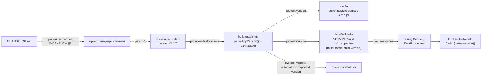
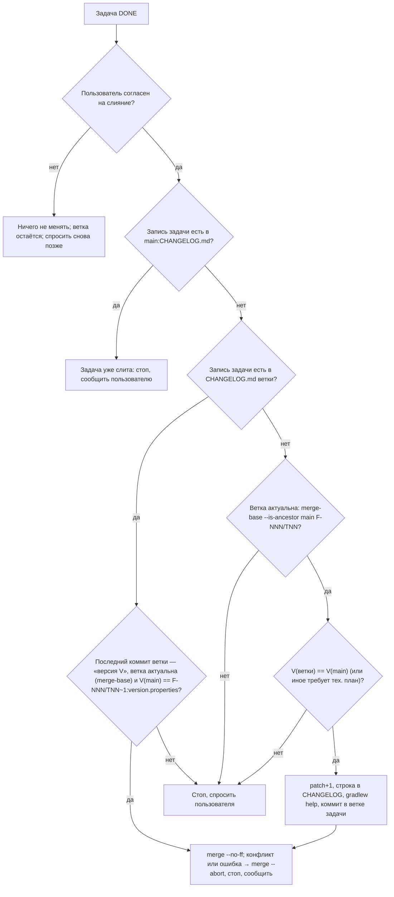

# F-012: Архитектура решения

| Поле   | Значение   |
|--------|------------|
| Автор  | architect  |
| Дата   | 2026-10-24 |
| ADR    | [ADR-0006](../../architecture/adr/ADR-0006-app-versioning.md); изменены заметками ADR-0002 (п. 6), ADR-0003 (п. 3) |

## Контекст
Каждая слитая в `main` задача получает patch-версию SemVer; `version.properties` — единственный источник версии;
`CHANGELOG.md` — журнал «версия → задача → название»; версия видна в имени jar и в `GET /actuator/info` без
аутентификации. Ретроспектива F-001: `1.0.0`/`1.0.1`/`1.0.2`, стартовое значение — `1.0.2`.

Ограничения из текущего состояния проекта:
- `build.gradle.kts`: `version = "0.0.1-SNAPSHOT"` — единственный литерал версии в сборке; `build/libs` сейчас содержит
  `auto-statistic-0.0.1-SNAPSHOT.jar` и `-plain.jar`.
- Gradle 9.3.1, один модуль, без `buildSrc` (ADR-0002); configuration cache в `gradle.properties` не включён, но скрипт
  должен оставаться совместимым с ним (ленивые API, без чтения файлов «в обход» Gradle).
- ktlint проверяет `*.gradle.kts` (задача `ktlintKotlinScriptCheck`); detekt анализирует только `src/main/kotlin`, `src/test/kotlin`.
- `application.yaml`: `management.endpoints.web.exposure.include: health`, `show-details: never`;
  `HealthEndpointTest` проверяет, что `/actuator/env` → 404. Discovery `/actuator` по решению F-001 включён «до расширения exposure».
- Кода приложения, кроме `AutoStatisticApplication`, нет; доменных типов F-012 не вводит.

## Компоненты и границы



| Компонент | Задача | Что меняется |
|-----------|--------|--------------|
| `version.properties` (корень) | T01 | новый файл, ASCII, ключ `version` |
| `CHANGELOG.md` (корень) | T01 | новый файл: заголовок с пояснением формата + 3 записи F-001 |
| `build.gradle.kts` | T01, T02 | T01: чтение/валидация версии вместо литерала; T02: `springBoot { buildInfo { … } }`, системное свойство для тестов |
| `src/main/resources/application.yaml` | T02 | exposure `health,info`, discovery off, `info.git` off |
| `src/test/kotlin/com/autostatistic/InfoEndpointTest.kt` | T02 | новая Kotest-спецификация |
| `src/test/kotlin/com/autostatistic/HealthEndpointTest.kt` | T02 | только переименование теста про закрытые эндпоинты |
| `docs/WORKFLOW.md`, `.claude/commands/feature.md`, `.claude/agents/{kotlin-backend-developer,qa-engineer,tech-lead}.md` | T03 | правило поднятия версии |

Пакеты `com.autostatistic.*` не добавляются: ни бинов, ни контроллеров, ни доменных типов (версия — забота сборки и Actuator).

## API
| Метод | Путь | Запрос | Ответ | Ошибки |
|-------|------|--------|-------|--------|
| GET | `/actuator/info` | без аутентификации; `Accept: application/json` или любой | `200`, тело ровно `{"build":{"name":"auto-statistic","version":"<X.Y.Z>"}}`; `Content-Type: application/json` при `Accept: application/json`, иначе `application/vnd.spring-boot.actuator.v3+json` (оба — JSON) | `405` ProblemDetail на не-GET (поведение Actuator, не контракт) |
| GET | `/actuator/health` | — | без изменений (ADR-0003) | без изменений |
| GET | `/actuator` | — | — | `404` `application/problem+json` (discovery выключен; было `200`) |
| GET | `/actuator/{env,beans,configprops,loggers,metrics,mappings,threaddump,heapdump,…}` | — | — | `404` (как до задачи) |

Контракт `/actuator/info` — поля `build.version` (строка SemVer) и `build.name`; никаких других ключей (`time`, `group`,
`artifact`, `git`, `env`, `java`, `os`, `process`, `ssl`) в ответе нет — тест сравнивает тело целиком.

## Модель данных
БД не затрагивается. Файлы:

**`version.properties`** (ASCII, LF):
```properties
# Application version (SemVer X.Y.Z). Single source of truth for the build.
# Changed only by the orchestrator when a task is merged: docs/WORKFLOW.md, section 7.
version=1.0.2
```
Правила разбора: `java.util.Properties` из текста; ключ `version`; значение `.trim()`; regex
`^(0|[1-9]\d*)\.(0|[1-9]\d*)\.(0|[1-9]\d*)$`. Прочие ключи игнорируются.

| Ввод | Результат |
|------|-----------|
| файла нет | FAIL: `version.properties not found in the project root; it must contain 'version=X.Y.Z' (e.g. version=1.0.2)` |
| нет ключа / `version=` / только пробелы | FAIL: `version.properties: property 'version' is missing or empty; expected X.Y.Z (e.g. 1.0.2)` |
| `1.0`, `1.0.x`, `v1.0.0`, `1.0.0-SNAPSHOT`, `1.0.0.0`, `01.0.0`, `1.-1.0` | FAIL: `version.properties: invalid version '<значение>'; expected X.Y.Z - three non-negative integers without leading zeros, prefix or suffix (e.g. 1.0.2)` |
| `0.0.0`, `1.0.2`, `10.20.300`, `1.0.2 ` (хвостовой пробел) | OK, версия без пробелов |

Сообщения — на английском (сборка выводит их в консоль Windows, где кириллица может исказиться); формулировки
выше — эталон, дословное совпадение не обязательно, но каждое сообщение должно называть файл, проблему и ожидаемый формат.

**`CHANGELOG.md`** (UTF-8, LF):
```markdown
# Changelog

Журнал изменений auto-statistic. Одна запись — одна выполненная задача, слитая в `main`, формат строки:
`<версия> <F-NNN/TNN> <название задачи>` (название — из заголовка файла задачи). Новые записи — вверху,
между записями — пустая строка. Версия — patch-версия SemVer, поднимается на 1 при слиянии каждой задачи
по правилу [docs/WORKFLOW.md](docs/WORKFLOW.md), раздел 7. Текущая версия — в `version.properties`.

1.0.2 F-001/T03 Автоматические проверки качества кода в сборке

1.0.1 F-001/T02 Каркас Spring Boot-приложения с проверкой работоспособности

1.0.0 F-001/T01 Сборка Kotlin-проекта на Gradle
```
Запись — строка, соответствующая `^(0|[1-9]\d*)\.(0|[1-9]\d*)\.(0|[1-9]\d*) F-\d{3}/T\d{2} \S.*$`; строки пояснения
так не начинаются. Пустая строка между записями нужна, чтобы Markdown не склеивал записи в один абзац при просмотре
(GitHub/IDE); формат самой записи от этого не меняется. Самая верхняя запись = значение `version.properties`.

**`build/bootBuildInfo/META-INF/build-info.properties`** (генерируется, не коммитится): `build.name=auto-statistic`,
`build.version=<X.Y.Z>`.

## Доменная модель
Не вводится: в коде приложения версии нет. «Тип версии» существует только как функция разбора в build-скрипте:

```kotlin
// build.gradle.kts — top-level функция скрипта; бросает GradleException, возвращает валидную строку X.Y.Z
fun parseAppVersion(propertiesText: String?): String
```
Это граница сборки, а не домен: исключение — штатный способ уронить конфигурацию Gradle, `Either` здесь неуместен.

## Потоки

### Поток 1. Сборка (T01)
1. Фаза конфигурации: `providers.fileContents(layout.projectDirectory.file("version.properties")).asText.orNull`
   (нет файла → `null`); файл регистрируется как вход configuration cache.
2. `parseAppVersion(text)` → валидная строка или `GradleException` (сборка падает до выполнения задач, `BUILD FAILED`
   с сообщением из таблицы).
3. `version = <результат>` (до блоков, использующих `project.version`); `bootJar` → `auto-statistic-<X.Y.Z>.jar`,
   `jar` → `auto-statistic-<X.Y.Z>-plain.jar`.
4. Смена версии в файле: следующая сборка переконфигурируется (configuration cache: «file 'version.properties' has
   changed»), имя jar новое. Старые jar в `build/libs` не удаляются без `clean` — штатное поведение Gradle.

### Поток 2. Версия в рантайме (T02)
1. `bootBuildInfo` (входы: `project.version`, `project.name`, excludes) пишет `build-info.properties`; up-to-date, пока
   версия не изменилась (нет `build.time`).
2. Ресурсы `main` включают его → в jar и в тестовом classpath `META-INF/build-info.properties`.
3. Boot создаёт `BuildProperties`, `BuildInfoContributor` отдаёт `build` в `/actuator/info`.
4. Тест получает ожидаемую версию через системное свойство `autostatistic.expected-version`, выставленное в
   `tasks.test` из того же значения `project.version` (версия не дублируется в тестах).

### Поток 3. Поднятие версии при слиянии (T03; до слияния T03 оркестратор применяет его по этому разделу)
> **Нормативный текст — `docs/WORKFLOW.md`, раздел 7, подраздел «Версия и CHANGELOG при слиянии задачи»** (действует
> после слияния F-012/T03). Схема и шаги ниже — упрощённая спецификация, по которой T03 проектировалась и по которой
> сливалась T01; в деталях (проверка записи задачи по полной строке, критерий актуальности ветки по merge-base, вливание
> `main` в отставшую ветку, `merge --abort`, сверка V(main) с `F-NNN/TNN~1:version.properties` при повторном запуске,
> нумерация шагов) они устарели. При расхождении действует WORKFLOW §7.

Исполнитель — оркестратор (основная сессия). Все команды — в корне репозитория.



Отставшая ветка (`E -- нет`): с согласия пользователя `main` вливается в ветку задачи (`merge --no-ff`, конфликт →
`merge --abort`), `clean build` зелёный, затем процедура заново — подробно в WORKFLOW §7, шаг 4.

1. **Предусловия:** статус задачи `DONE` в её файле; пользователь явно согласился сливать именно эту ветку;
   `git status` чистый; `git switch F-NNN/TNN`.
2. **Защита от двойного поднятия:**
   - `git show main:CHANGELOG.md` содержит строку `^\S+ F-NNN/TNN ` → задача уже в `main`: ничего не делать, сообщить.
   - `CHANGELOG.md` ветки содержит такую строку → поднятие уже сделано: если последний коммит ветки —
     `F-NNN/TNN: версия …`, перейти к шагу 6; иначе стоп и вопрос пользователю.
3. **Защита от устаревшей ветки:** значение `version` в `version.properties` ветки должно совпадать с
   `git show main:version.properties`. Не совпадает (ветка ответвилась до слияния другой задачи) → стоп, вопрос
   пользователю (предложить влить `main` в ветку задачи); самостоятельно конфликты не разрешать, `rebase` запрещён.
4. **Поднятие:** `X.Y.Z` → `X.Y.(Z+1)`; в `version.properties` меняется только значение `version`; в `CHANGELOG.md`
   первой записью (над прежней верхней, через пустую строку) — `X.Y.(Z+1) F-NNN/TNN <название>`, где название —
   текст после `# F-NNN/TNN: ` в заголовке файла задачи; остальные строки не меняются.
   Major/minor (`X+1.0.0`, `X.Y+1.0`) — только по явному указанию пользователя, тем же коммитом вместо patch.
5. **Проверка и коммит:** `./gradlew help -q` (Windows: `gradlew.bat help -q`) — версия разбирается без ошибки; затем
   `git add version.properties CHANGELOG.md` и коммит **только этих двух файлов** в ветку задачи:
   `F-NNN/TNN: версия X.Y.(Z+1)` (+ строка `Co-Authored-By`, если задана в сессии; без `--no-verify`).
6. **Слияние:** `git switch main` → `git merge --no-ff F-NNN/TNN`. Ветка не удаляется. Сообщить пользователю новую версию.
7. **Отказ пользователя / задача не `DONE`:** ни ветка, ни `main` не меняются; при последующем согласии процедура
   выполняется с шага 1 (версия вычисляется на момент слияния).

Последовательные слияния дают последовательные номера без пропусков, т.к. база — всегда текущий `main` (шаг 3), а
следующая задача ответвляется от обновлённого `main` (раздел 7). Ожидаемо: T01 → `1.0.3`, T03 → `1.0.4`, T02 → `1.0.5`.

## Альтернативы
См. ADR-0006 («Рассмотренные альтернативы»). Дополнительно по фиче:
- **Автоматический тест «верхняя запись CHANGELOG = version.properties»** — отклонён: явно out of scope (Q10); при
  желании — отдельная задача.
- **Gradle TestKit-тест на негативные сценарии AC-8 T01** — отклонён (YAGNI): потребовал бы копировать проект во
  временный каталог и `gradleTestKit()`; проверяется вручную QA (временные правки, не коммитятся — как в F-001).
- **Отключить plain-jar (`tasks.jar { enabled = false }`)** — не делаем: не требуется AC, меняет поведение сборки
  за пределами фичи; исполняемый — тот, что без `-plain`.
- **Хранить процедуру поднятия в скрипте (`bump-version.sh`/Gradle-задача)** — отклонено: автоматика out of scope;
  при повторяющихся ошибках оркестратора — отдельной фичей.
- **Объединить T02 и T01** — нет: T01 — сборка и файлы, T02 — HTTP-поведение и безопасность Actuator; разные AC и
  риски, обе S.

## Риски и открытые вопросы
- **Ключи `excludes` (`group`, `artifact`) у `bootBuildInfo`.** Документация Boot 4.1.2 показывает пример только для
  `time`; по исходникам `BuildInfo` исключаются все стандартные свойства. Если `group`/`artifact` всё же попадут в
  ответ — тест T02 упадёт; разработчик ставит `BLOCKED` с фактическим телом ответа (не расширять контракт самому).
- **Конфликты при слиянии отставших веток** — закрываются шагом 3 Потока 3 (стоп и вопрос пользователю).
- **Ошибка оркестратора при ручном поднятии** (опечатка в версии) ловится `gradlew help` (формат), но не
  «пропуск номера» — защищает только процедура; автоматической сверки нет (Q10).
- **Discovery `/actuator` → 404** — изменение наблюдаемого поведения F-001; контрактом не было, потребителей нет.
- **Рабочее дерево не чистое**: сейчас не закоммичены правки `docs/WORKFLOW.md` (раздел 7), `.claude/agents/*`,
  `.claude/commands/feature.md`, `docs/features/README.md`, `docs/features/_templates/task.md` и каталог F-012. До старта
  T01 их нужно закоммитить в `main` (решение пользователя, раздел 7 «Планирование»), иначе разработчик уйдёт в `BLOCKED`.
- **`CLAUDE.md`** (инструкции оркестратора) уже отсылает к `docs/WORKFLOW.md`; правка не планируется. Если пользователь
  хочет явное упоминание процедуры версии в `CLAUDE.md` — отдельное согласие (не блокирует).

## Порядок реализации задач
T01 → T03 → T02 (рекомендация PM подтверждена). T02 и T03 технически независимы (обе зависят только от T01); T03 раньше
T02, чтобы при слиянии T02 правило уже действовало по регламенту, а не по этому документу. Ожидаемые версии:
T01 — `1.0.3`, T03 — `1.0.4`, T02 — `1.0.5`.

## Проверка решения (сводка)
| Что | Как | Тип |
|-----|-----|-----|
| Версия из файла в имени jar, смена версии без правки других файлов | `./gradlew clean build` с `1.0.2`, `1.0.7`, `0.0.0`, `10.20.300` → `build/libs/auto-statistic-<v>.jar` | manual (QA) |
| Невалидная версия роняет сборку с понятным сообщением | временные правки `version.properties` по таблице «Модель данных» | manual (QA) |
| Нет `0.0.1-SNAPSHOT` / литералов версии | `git grep -n "0.0.1-SNAPSHOT" -- . ':!docs/features/F-001-*'` и `git grep -nE "version\s*=\s*\"[0-9]"` по `*.kts`, `src/` | manual (QA) |
| Совместимость с configuration cache | `./gradlew build --configuration-cache` дважды (второй раз — reuse), затем смена версии → cache invalidated | manual (QA) |
| `/actuator/info` отдаёт ровно `build.name` + `build.version` = версии сборки | `InfoEndpointTest` | auto |
| Прочие эндпоинты и `/actuator` → 404, health без изменений | `InfoEndpointTest`, `HealthEndpointTest` | auto |
| Версия jar = версия `/actuator/info` | `java -jar build/libs/auto-statistic-1.0.2.jar --server.port=18082` + `curl -s localhost:18082/actuator/info` | manual (QA) |
| Правило процесса однозначно и без противоречий | чтение `WORKFLOW.md` §4, §5, §6, §7 + `feature.md` команды; фактическая проверка — история `main` после слияний T01/T03 | manual (QA / оркестратор) |
