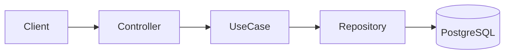

# F-NNN: Архитектура решения

| Поле   | Значение   |
|--------|------------|
| Автор  | architect  |
| Дата   | YYYY-MM-DD |
| ADR    | ADR-NNNN (если есть) |

## Контекст
Краткое резюме фичи и ограничения, влияющие на решение.

## Компоненты и границы
Какие модули/пакеты затрагиваются или создаются. Диаграмма (Mermaid) при необходимости:

## API
| Метод | Путь | Запрос | Ответ | Ошибки |
|-------|------|--------|-------|--------|

## Модель данных
Таблицы, поля, индексы, миграции (имя файла миграции).

## Доменная модель
Ключевые типы (value objects, сущности), доменные ошибки (sealed-иерархия), инварианты.

## Потоки
Пошаговое описание основных сценариев, включая обработку ошибок.

## Альтернативы
Что рассматривалось и почему отвергнуто.

## Риски и открытые вопросы
- ...

## Порядок реализации задач
T01 → T02 → (T03 ∥ T04) → T05
